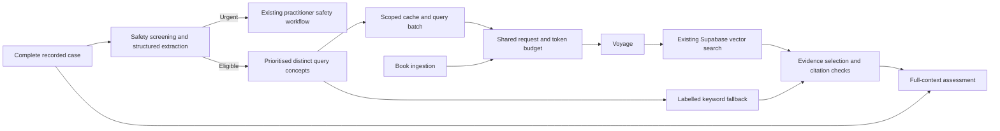

# RAG query optimisation

## Audit and plan

The frontend sends the chosen search mode to the case analysis endpoint. `backend/app/ai/rag/case_analysis.py` flattens the recorded complaint and symptom rows, including history, medication, family history, modalities and notes. Clinical Reports can append authorised image observations in `backend/app/api/routes/clinical_workflow.py`. The complete text goes to the saved chat provider. Voyage receives the generated search phrases. The shared retriever in `backend/app/ai/rag/retrieval.py` sends their vectors to the existing Supabase `match_chunks` RPC and retains indexed citation metadata.

The old path generated up to eight phrases and embedded each separately. Clinical Reports reused the immediately preceding vector for its second category. The website ingestion service paced each job independently and used the same provider configuration, so concurrent jobs and case requests could exceed the shared account allowance. The repository config uses 3 requests per minute for ingestion and a 3,000-token target per ingestion request. The 10,000-token allowance reported in the brief needs confirmation in the account dashboard. Wide keyword OR matches and cosine similarity alone can rank passages that match a modality or incidental term without addressing the complaint.

Implement structured extraction, a configurable primary query allowance and an optional focused follow-up when evidence is thin. Use the existing retrieval adapters and a local SQLite budget that spans worker processes. Keep query embeddings in a bounded, practitioner-scoped in-memory cache. Add privacy-safe diagnostics and verify request counts and relevance with controlled fixtures before claiming any improvement.

## Implementation

- `backend/app/ai/rag/case_analysis.py` adds structured findings and query planning. Both case workflows keep the original case for assessment. The planner prioritises distinct symptoms, preserves opposite modalities, and rejects phrases containing known patient identifiers or recognisable contact details. Red-flag checks run before embedding.
- `backend/app/ai/rag/clinical_research.py` and `backend/app/ai/rag/retrieval.py` batch the initial concepts, permit a focused follow-up for thin evidence, and use the same vectors across requested categories. Weak off-topic passages are screened before fusion. Clinical Reports retain source excerpts, exact-quote checks and source diversity.
- `backend/app/services/embeddings.py` deduplicates and batches requests, retains typed failures, and caches vectors for five minutes in practitioner-scoped process memory. Cache keys are keyed digests. Cross-practitioner requests cannot reuse an entry.
- `backend/app/services/voyage_budget.py` shares a FIFO rolling-minute budget across workers that use the same SQLite file. It reserves requests and tokens before sending, using the locally available model tokenizer or conservative UTF-8 size estimation. It reconciles reservations with provider token usage when available. Queue waits are bounded. Document ingestion in `backend/app/ai/ingestion/service.py` honours the existing operator pause while waiting and leaves unsent chunks resumable.
- `backend/app/services/rag_metrics.py` emits a `rag_run` summary for operators with an opaque run ID, counts, wait and retrieval durations, and sanitised fallback reasons. The case entry points in `backend/app/api/routes/cases.py` and `clinical_workflow.py` scope the cache and keep patient content out of tracing.
- `backend/app/core/config.py` defines settings. `.gitignore` excludes the local quota ledger. Regression tests are in `backend/tests/test_query_optimisation.py`, `test_case_analysis.py` and `test_clinical_workflow.py`.

## Configuration and verification

The local app loads `voyage-4-lite`, `EMBEDDING_REQUESTS_PER_MINUTE=3`, `EMBEDDING_TOKENS_PER_MINUTE=10000` and a 3,000-token ingestion target. Compare the request and token limits with the provider dashboard before changing them. The account-side allowance was not queried. `RAG_PRIMARY_QUERIES=4` and `RAG_FOLLOW_UP_QUERIES=1` set the concept budgets. `EMBEDDING_QUERY_WAIT_SECONDS` sets the interactive queue wait. `EMBEDDING_BUDGET_PATH` can point cooperating workers to the same writable local ledger. Workers on separate hosts, older processes and other API consumers are outside this ledger.

The mock comparison sent three identical concepts separately and then as one batch. Requests dropped from three to one while fixture token usage stayed at nine. A warm search for the same practitioner needed zero calls. On a mock three-request tier, the fourth sequential request returned HTTP 429 and the single four-concept batch completed. The labelled relevance fixture retained both relevant sources and removed the incidental source, taking precision from two of three to two of two on that fixture only. The full-context pipeline fixture retained Urdu text, treatment history and a recorded negative response through final assessment.

These comparisons verify local behaviour. Live latency, billable token savings, case-level retrieval precision and the account-wide 429 rate still need authorised provider testing. The local quota queue supports cancellation before an ingestion request sends. A browser closing an already-running synchronous analysis may leave it running within the configured waits and provider timeout. No schema migration or re-indexing is needed.

The backend regression suite passed 335 tests. Ruff passed on the files changed for this work.
